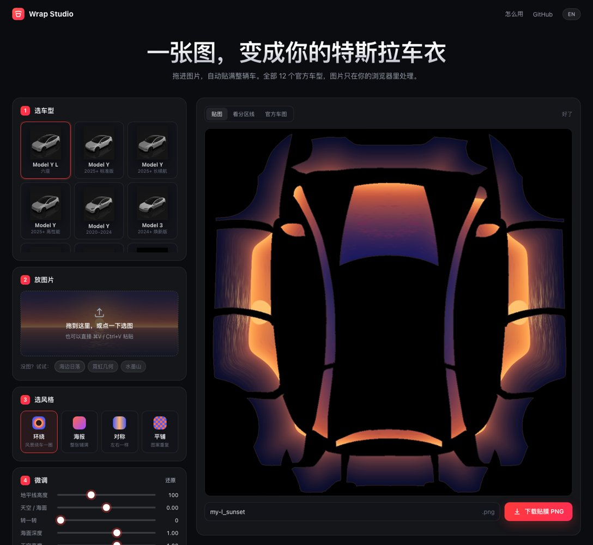

# Wrap Studio · 特斯拉车身贴膜生成器

**把图片拖进来，自动生成特斯拉 Paint Shop 贴膜。**
Drop in a picture, get a ready-to-use Tesla Paint Shop wrap.

### 👉 [在线使用 / Open the web app](https://elvin-li.github.io/tesla-wrap-studio/)



## 网页版 / Web app

- 支持全部 12 个官方车型：Model 3 / Y / Y L / S / X / Cybertruck。
- 五种风格：**环绕**（风景绕车一圈，地平线等高）、**海报**、**对称**、**平铺**、**车头脸**（脸放上引擎盖，人物立在两侧车门，其余是柔化背景）。
- 实时预览，可调地平线、缩放、旋转、亮度、色彩。
- 导出自动满足特斯拉要求：PNG、≤1024 px、< 1 MB、模板外纯黑、文件名 ≤ 30 字符。
- 可选 **AI**：填你自己的 OpenAI 格式接口（OpenAI、硅基流动、自建代理等），就能按文字生成新图、按文字改图、自动找脸。Key 只存在本机浏览器。
- 不用 AI 时，图片只在你的浏览器里处理，不会上传。用 AI 时，文字和图片会发给你填的接口。

All 12 official models · 5 styles (wrap-around, poster, mirror, tile, face-on-hood) · live preview ·
export always meets Tesla's rules (PNG, ≤1024 px, < 1 MB, black outside the template, name ≤ 30 chars) ·
optional AI with your own OpenAI-compatible API: make a picture from text, edit a picture, find the face ·
without AI everything runs locally in your browser.

## 放进车里 / Install in the car

1. U 盘（exFAT / FAT32）根目录建 `Wraps` 文件夹，放入 PNG（一次最多 10 张）。
2. 插车上：玩具箱 → 涂装店 → 贴膜。
3. 或用特斯拉 App 4.59+：创作 → 贴膜 → 上传。

## Python 工具（Model Y L 精细版） / Python toolkit

`make_wrap.py` 针对 Model Y L 做了实车校准：主角人物可连续贴满引擎盖 + 保险杠 + 翼子板，
车门躺姿人物、尾门 180° 修正、车上视角预览。详见 [README_中文.md](README_中文.md)。

```bash
pip install -r requirements.txt
sh examples/demo/run_example.sh
python make_wrap.py --bg my_scene.jpg --name myl_my_first.png
```

## 本地运行网页 / Run the web app locally

```bash
python3 -m http.server 8000 --bind 127.0.0.1 --directory docs
# open http://127.0.0.1:8000
```

## 说明 / Notes

- 车型模板运行时从特斯拉官方仓库 [teslamotors/custom-wraps](https://github.com/teslamotors/custom-wraps)（固定版本）读取，本仓库不复制。
- 示例图片全部由 `tools/make_demo_images.py` 程序生成，无版权问题。
- 本项目与特斯拉公司无关。请只使用你有权使用的图片。
- Not affiliated with Tesla, Inc. Only use pictures you have the rights to.

MIT License.
